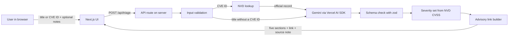
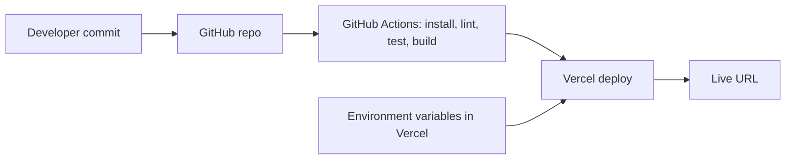

# Architecture Notes: Vulnerability Triage Assistant (v1)

These notes explain how the pieces fit together and why. `spec.md` defines what to build; this file explains the structure behind it.

## 1. System overview

## 2. Components

| Component | Responsibility | Runs on |
|---|---|---|
| UI | Input box, optional extra-notes field, results view, copy button, loading and error states | Browser |
| API route (`/api/triage`) | Receives the request, orchestrates validation, the AI call, and the response | Server |
| Input validation | Enforces length and character rules on the title and notes | Server |
| NVD lookup | For CVE IDs, fetches the official record from the NVD CVE API (8 second timeout, one hour cache) and extracts the description, CVSS score, and affected ranges | Server |
| AI call | Sends the system prompt plus user input (and the NVD record, if found) to Gemini and requests structured output | Server |
| Schema check (zod) | Rejects AI responses that do not match the five-section schema | Server |
| Severity override | Replaces the model's severity with NVD's CVSS severity (or Unknown if NVD has no score) | Server |
| Advisory link builder | Builds the CVE page link, the Microsoft Security Update Guide link, or an NVD search link | Server |

Validation, the NVD lookup, the AI call, the schema, and the link builder are separate modules so each can be unit tested on its own.

## 3. Request lifecycle

1. The user submits a title or CVE ID, with optional extra notes.
2. The API route checks the rate limit, then validates and normalizes the input (for example, uppercase CVE IDs). Invalid input returns 400.
3. If the input is a CVE ID, the route looks it up in NVD. The lookup never throws: a missing record, a timeout, or a rate limit simply means no grounding data.
4. The route calls Gemini with the system prompt, the user input, and the NVD record (if found), requesting the five-section structure.
5. The response is checked against the zod schema. A mismatch returns a friendly 502 error and allows retry.
6. If an NVD record was found, the app sets the severity from NVD's CVSS data (or Unknown if NVD has no score).
7. The app builds the advisory link from the original input (not from AI output).
8. The route returns the five sections, the link, and a grounding note saying where the data came from. The UI renders everything as plain text and shows the "verify before deploying" note.

## 4. Trust boundaries

- **Browser to server:** all input is untrusted. Validation runs on the server; client checks are only for convenience.
- **Server to AI provider:** the API key lives only in a server environment variable. User text is passed as data, not instructions.
- **AI output to UI:** AI output is untrusted until it passes the schema check, and is rendered as plain text, never raw HTML.
- **Advisory link:** generated by the app, never by the AI, so it cannot be fabricated.
- **NVD to prompt:** NVD text is third-party content. It is escaped and passed to the model as data inside tags, never as instructions.
- **Server to NVD:** the optional `NVD_API_KEY` stays in a server environment variable. If NVD fails, the app continues without grounding and says the result is not verified.

## 5. Deployment pipeline

- Secrets are set in the Vercel dashboard and never committed. The repo contains only `.env.example` with placeholders.
- Vercel Analytics provides basic monitoring of the live app.

## 6. Key design decisions

| Decision | Why | Trade-off |
|---|---|---|
| Next.js with a server API route | Keeps the API key off the client and deploys easily on Vercel | Requires understanding the server/client split |
| Structured output with zod | Predictable UI and easy unit tests | A schema mismatch needs error handling |
| App-built advisory link | Prevents invented URLs | Fallback links for non-Microsoft titles are generic NVD searches |
| Retrieve the NVD record at request time instead of training the model | Always current, no training cost, and the model explains facts instead of recalling them | Depends on NVD availability and rate limits (mitigated by a fallback and a one hour cache) |
| Severity set by code from CVSS data | The rating comes from data, not model judgment | Only available when NVD has published a CVSS score |
| Optional extra-notes field | Lets the AI work from real scanner data for recent patch bundles | Adds one more input to validate |
| No database or authentication in v1 | Smaller scope, faster to finish and secure | No saved history or accounts until v2 |

## 7. Known limitations and v2 candidates

- For CVE IDs, facts come from NVD. For titles without a CVE ID (such as patch bundles), the model has no grounding data and may not know very recent updates. Mitigation in v1: the extra-notes field and the verify note. In v2: ground patch-bundle titles with vendor data (for example, Microsoft Security Update Guide).
- Patch-bundle titles cover many CVEs, so severity can be `Unknown`.
- NVD may not have scored a new CVE yet, and unauthenticated NVD requests are heavily rate limited. The app caches lookups and falls back gracefully; an optional API key raises the limit.
- Affected ranges such as "versions before 2.17.0" are interpreted as "2.17.0 is the first fixed version of that release line," which should still be verified against the vendor advisory.
- Not in v1: device remediation tracking, spreadsheet upload, user accounts, saved history.
