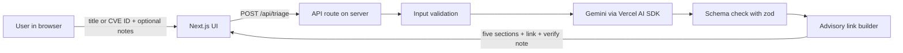
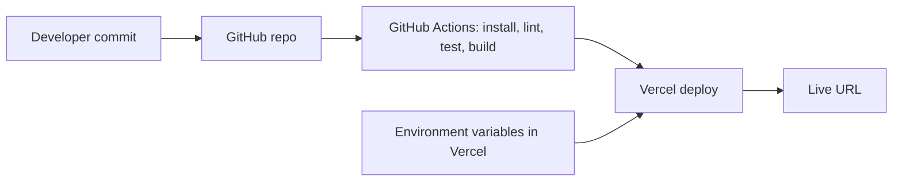

# Architecture Notes: Vulnerability Triage Assistant (v1)

These notes explain how the pieces fit together and why. `spec.md` defines what to build; this file explains the structure behind it.

## 1. System overview

## 2. Components

| Component | Responsibility | Runs on |
|---|---|---|
| UI | Input box, optional extra-notes field, results view, copy button, loading and error states | Browser |
| API route (`/api/triage`) | Receives the request, orchestrates validation, the AI call, and the response | Server |
| Input validation | Enforces length and character rules on the title and notes | Server |
| AI call | Sends the system prompt plus user input to Gemini and requests structured output | Server |
| Schema check (zod) | Rejects AI responses that do not match the five-section schema | Server |
| Advisory link builder | Builds the CVE page link, the Microsoft Security Update Guide link, or an NVD search link | Server |

Validation, the AI call, the schema, and the link builder are separate modules so each can be unit tested on its own.

## 3. Request lifecycle

1. The user submits a title or CVE ID, with optional extra notes.
2. The API route validates and normalizes the input (for example, uppercase CVE IDs). Invalid input returns 400.
3. The route calls Gemini with the system prompt and the user input, requesting the five-section structure.
4. The response is checked against the zod schema. A mismatch returns a friendly 502 error and allows retry.
5. The app builds the advisory link from the original input (not from AI output).
6. The route returns the five sections, the link, and the "verify before deploying" note.
7. The UI renders everything as plain text.

## 4. Trust boundaries

- **Browser to server:** all input is untrusted. Validation runs on the server; client checks are only for convenience.
- **Server to AI provider:** the API key lives only in a server environment variable. User text is passed as data, not instructions.
- **AI output to UI:** AI output is untrusted until it passes the schema check, and is rendered as plain text, never raw HTML.
- **Advisory link:** generated by the app, never by the AI, so it cannot be fabricated.

## 5. Deployment pipeline

- Secrets are set in the Vercel dashboard and never committed. The repo contains only `.env.example` with placeholders.
- Vercel Analytics provides basic monitoring of the live app.

## 6. Key design decisions

| Decision | Why | Trade-off |
|---|---|---|
| Next.js with a server API route | Keeps the API key off the client and deploys easily on Vercel | Requires understanding the server/client split |
| Structured output with zod | Predictable UI and easy unit tests | A schema mismatch needs error handling |
| App-built advisory link | Prevents invented URLs | Fallback links for non-Microsoft titles are generic NVD searches |
| Optional extra-notes field | Lets the AI work from real scanner data for recent patch bundles | Adds one more input to validate |
| No database or authentication in v1 | Smaller scope, faster to finish and secure | No saved history or accounts until v2 |

## 7. Known limitations and v2 candidates

- The AI may not know details of very recent updates. Mitigation in v1: the extra-notes field and the verify note. In v2: ground the AI with official NVD data.
- Patch-bundle titles cover many CVEs, so severity can be `Unknown`.
- Not in v1: device remediation tracking, spreadsheet upload, user accounts, saved history.
